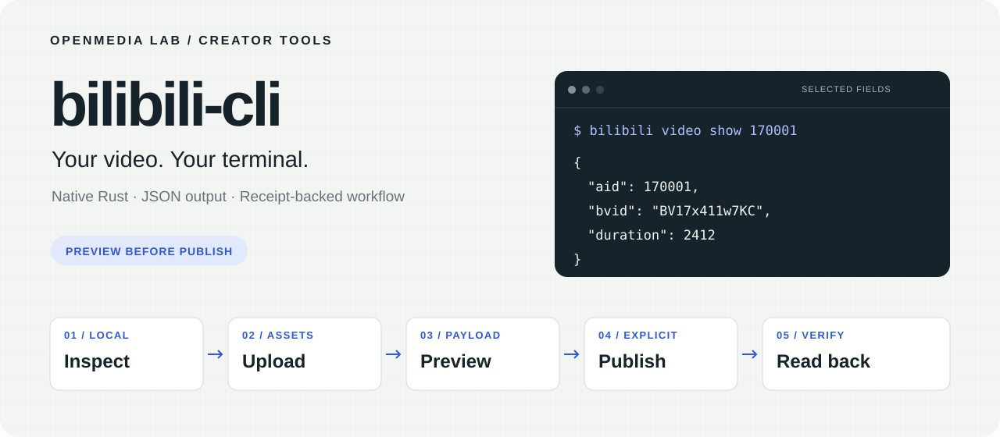

<p align="center">
  
</p>

<h1 align="center">bilibili-cli</h1>

<p align="center">A native Rust CLI for reading Bilibili and publishing your videos from the terminal.</p>

<p align="center">
  <a href="#quick-start">Quick start</a> ·
  <a href="#publish-a-video">Publish a video</a> ·
  <a href="docs/usage.md">Command guide</a> ·
  <a href="README_ZH.md">中文</a>
</p>

<p align="center">
  <a href="https://github.com/OpenMedia-Lab/bilibili-cli/actions/workflows/ci.yml"></a>
  <a href="LICENSE"></a>
</p>

Read public video details as JSON. Check an MP4 before uploading. Sign in with the
Bilibili App, retain upload receipts, and inspect the exact submission payload.
**`submit` produces an offline preview; `submit --publish` sends it to Bilibili.**

## Quick start

Install a current stable [Rust toolchain](https://rustup.rs/). Local MP4 inspection
also needs `ffprobe` from [FFmpeg](https://ffmpeg.org/download.html).

```sh
git clone https://github.com/OpenMedia-Lab/bilibili-cli.git
cd bilibili-cli
cargo install --path . --locked

bilibili --version
bilibili video show 170001
```

The public read needs no login. It returns JSON on stdout; progress and errors go
to stderr. The hero shows selected fields from this read, checked on 2026-10-27.

### Work with your account

```sh
bilibili auth login
# Scan the terminal QR code with the Bilibili App and confirm on your phone.
bilibili status
bilibili archives --page 1 --page-size 20
```

For a graphical QR, add `--qr-file ./bilibili-login.svg` with a new output path.
Already have your own exported cookies? See [session import](docs/usage.md#sessions).

## Choose your next task

| You want to… | Start here |
| --- | --- |
| Read a public video's details | `bilibili video show <BVID-or-AID>` |
| Check a video and cover locally | `bilibili video check video.mp4` · `bilibili cover check cover.png` |
| Validate metadata and media offline | `bilibili plan --metadata submission.json --video video.mp4` |
| Upload a file, then resume if interrupted | [Uploads and receipts](docs/usage.md#uploads-and-receipts) |
| Preview, submit and verify a video | [Publishing workflow](#publish-a-video) |
| Choose current categories and declarations | `bilibili categories` · `bilibili statements` |

## Publish a video

The workflow separates **local checks**, **uploaded assets**, and the **submission**.
An uploaded video is reusable material; an offline preview is not a remote draft.

**1. Prepare and inspect locally**

Copy [examples/submission.json](examples/submission.json), edit its title, tags and
description, and select the current category with `bilibili categories`.

```sh
cp examples/submission.json ./submission.json
bilibili plan --metadata ./submission.json --video ./video.mp4
bilibili cover check ./cover.png
```

**2. Upload the assets**

```sh
bilibili cover upload ./cover.png --receipt ./cover.receipt.json
# Put the returned cover URL into submission.json's cover field.
bilibili video upload ./video.mp4 --receipt ./video.receipt.json
```

**3. Review the payload, then submit**

```sh
bilibili submit --metadata ./submission.json --upload ./video.receipt.json

# Run only after reviewing the video, cover and metadata:
bilibili submit --metadata ./submission.json --upload ./video.receipt.json \
  --publish --result ./publish.receipt.json

bilibili readback ./publish.receipt.json --public
```

A receipt records what was uploaded or submitted. Reuse the same upload receipt
with `--resume` after an interrupted transfer. If a submission outcome is uncertain,
read it back before retrying. Platform acceptance and public availability are
separate states. [Recovery details →](docs/usage.md#submission-and-readback)

For multi-part videos, repeat `--upload` in the desired part order and optionally
set `part_titles` in metadata. [Metadata reference →](docs/usage.md#metadata)

## Documentation

| Guide | What's inside |
| --- | --- |
| [Command guide](docs/usage.md) · [中文操作手册](docs/usage.zh-CN.md) | Sessions, local checks, uploads, metadata, submission and recovery |
| [Design](docs/design.md) | Native protocol and implementation boundaries |
| [Initial verification](docs/verification.md) · [QR verification](docs/qr-login-verification.md) | Dated checks and the limits of their evidence |
| [Third-party notices](THIRD_PARTY_NOTICES.md) | Protocol sources and licenses |

This is an unofficial client using the existing Bilibili web session, not the
platform's OAuth SDK. Web interfaces can change. This version does not implement
editing/deleting submissions, scheduled publishing or collection management.

## Contribute

Bring a reproducible CLI issue, a focused improvement, or a documentation fix.
Run `cargo fmt --check`, `cargo clippy --locked --all-targets -- -D warnings` and
`cargo test --locked` before sending a pull request. Keep credentials and private
receipts out of issues and commits.

Built by [OpenMedia-Lab](https://github.com/OpenMedia-Lab).
Making the video first? Start with [videodeck](https://github.com/OpenMedia-Lab/videodeck).
Licensed under [MIT](LICENSE); third-party terms are documented separately.
